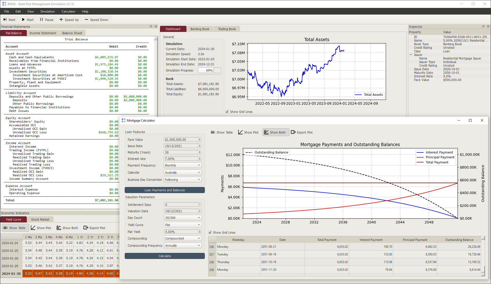
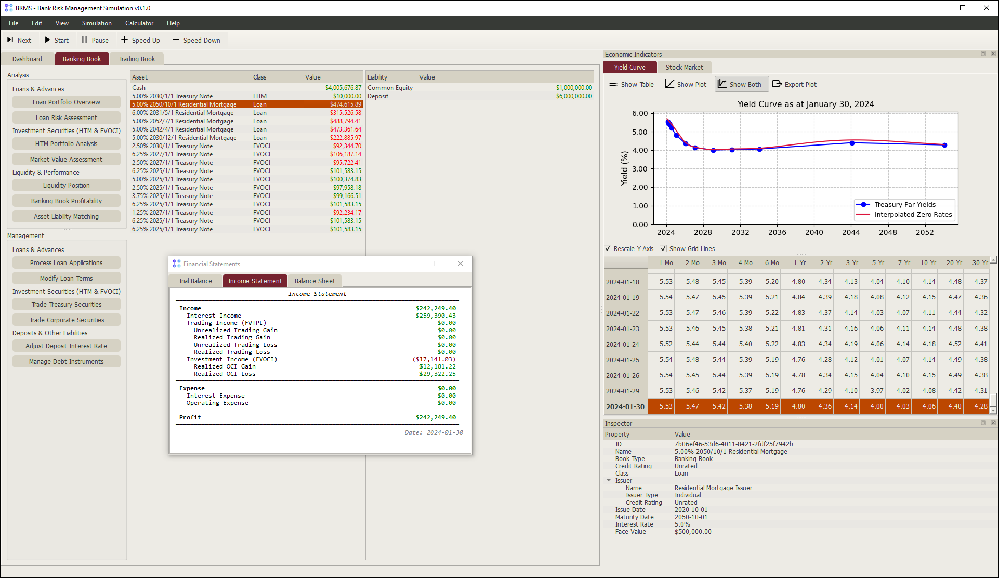
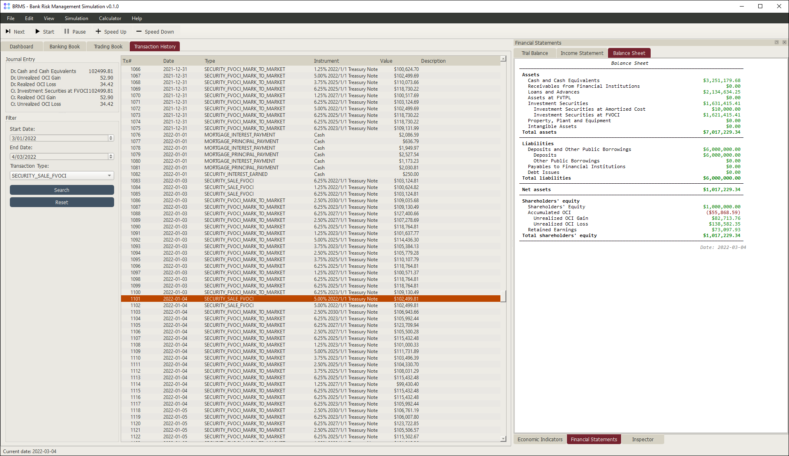

# BRMS - Bank Risk Management Simulation


BRMS is an educational tool designed to provide users with an in-depth understanding of bank risk management practices. It allows users to simulate and respond to various risk scenarios, and analyze the impact on a bank's financial health.

It is developed by Dr. [Mingze Gao](https://mingze-gao.com) from the Department of Applied Finance at [Macquarie Business School](https://www.mq.edu.au/macquarie-business-school).

> [!NOTE]  
> This application is under active development for use in my teaching AFIN8003 Banking and Financial Intermediation at the Macquarie University.

## How It Works

A simulation in BRMS begins with a predefined set of banking and trading books, covering instruments from standard mortgages to HTM, FVOCI, and FVTPL securities (e.g., Treasuries). Each simulation unfolds through daily scenarios, incorporating economic data such as yield curves. As users navigate these scenarios, the bank's performance is automatically computed and reported under IFRS accounting. Capital adequacy and liquidity ratios are assessed following the Basel III framework, with RWAs calculated based on the selected approach. Users can actively adjust exposures through various risk mitigation strategies, and their overall performance is analyzed at the simulation’s conclusion.  

## Stress-test lab

The engine also runs as a stress-test lab: put a bank's balance sheet (from a bank file or a US bank's
Call Report; SVB, Signature, First Republic and JPMorgan ship as case studies) through historical rates or the Basel interest-rate shocks, and read its statements,
regulatory capital, unrealised losses and interest-rate risk day by day.

It runs on your own computer: install it, start it, and use it in your browser at
`http://127.0.0.1:8765`.

```bash
uv tool install "brms[web]>=0.2"   # or: python -m pip install "brms[web]>=0.2" (Python 3.11+)
brms-web                           # the lab in your browser
```

Step by step, for Windows, macOS and Linux: [Install on your computer](docs/lab/install.md).

Start with the [quick start](docs/lab/quickstart.md), then the tutorials, e.g.
[why SVB failed, step by step](docs/lab/tutorials/svb-2022.md). Everything is in
[the Stress Lab documentation](docs/lab/index.md) (also at [bankrisk.org](https://bankrisk.org)).

## GUI Demo

Here is an overview of the user interface at this stage (2025-01-31).






