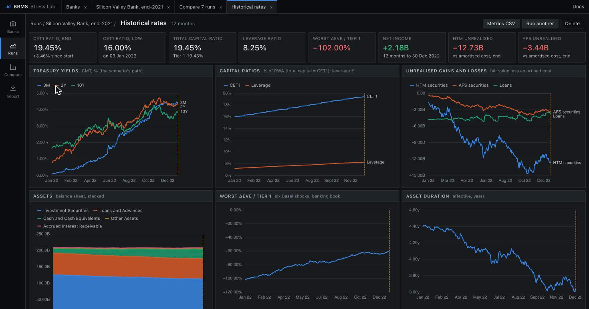
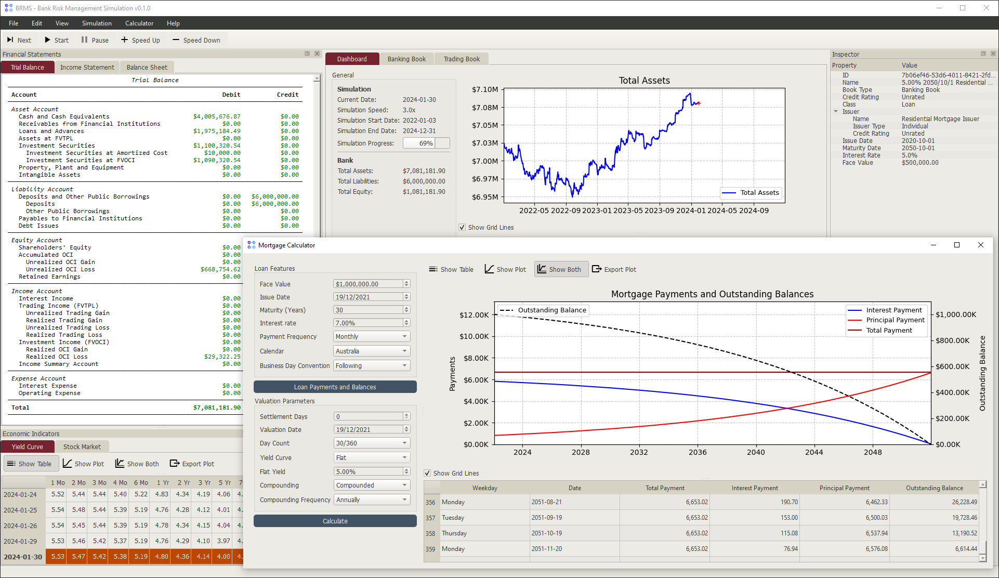
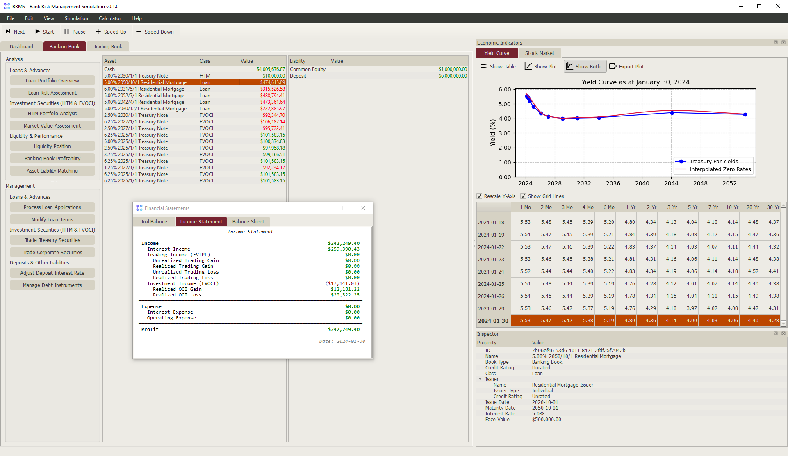
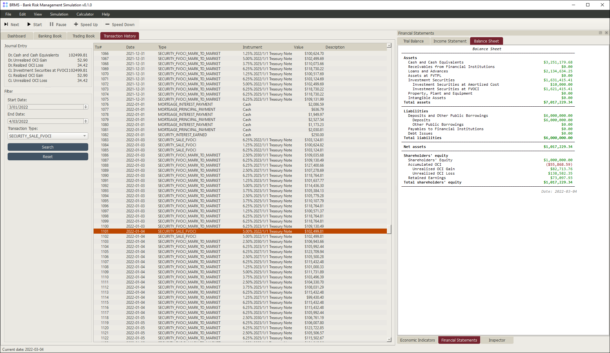

---
hide:
  - navigation
---

# BRMS - Bank Risk Management Simulation

BRMS is an educational tool designed to provide users with an in-depth understanding of bank risk management practices. It allows users to simulate and respond to various risk scenarios, and analyze the impact on a bank's financial health. It is developed by Dr. [Mingze Gao](https://mingze-gao.com) from the Department of Applied Finance at [Macquarie Business School](https://www.mq.edu.au/macquarie-business-school).

## Stress Lab

Run a bank's balance sheet (any US bank from its Call Report, or your own) through historical
rates or the Basel interest-rate shocks, and read its books, regulatory capital, unrealised losses
and interest-rate risk day by day, in your browser or from Python.

```bash
pip install "brms[web]"
brms-web
```



[Quick start](lab/quickstart.md) · [Why SVB failed, step by step](lab/tutorials/svb-2022.md) ·
[The Basel shocks across banks](lab/tutorials/basel-shocks.md) · [All of the Stress Lab](lab/index.md)

## Desktop app

!!! note

    The desktop app was built for teaching AFIN8003 Banking and Financial Intermediation at Macquarie University.

### How It Works

A simulation in BRMS begins with a predefined set of banking and trading books, covering instruments from standard mortgages to HTM, FVOCI, and FVTPL securities (e.g., Treasuries). Each simulation unfolds through daily scenarios, incorporating economic data such as yield curves. As users navigate these scenarios, the bank's performance is automatically computed and reported under IFRS accounting. Capital adequacy and liquidity ratios are assessed following the Basel III framework, with RWAs calculated based on the selected approach. Users can actively adjust exposures through various risk mitigation strategies, and their overall performance is analyzed at the simulation’s conclusion.

### GUI Demo

Here is an overview of the user interface at this stage (2025-01-31).






