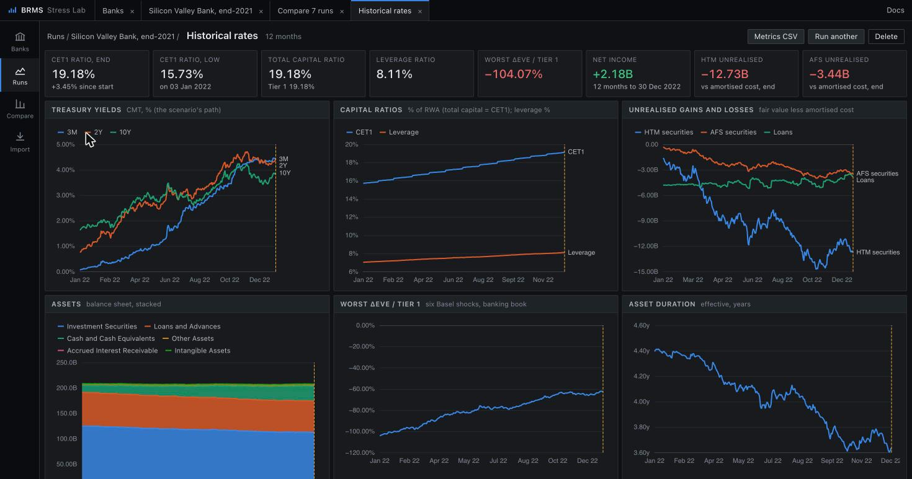
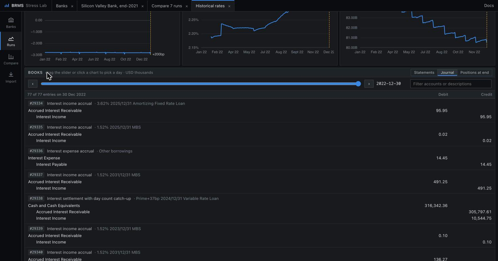

# Reading a run

What every part of a run's page shows, and how to read it.

## The header

The scenario, any liquidity stress, the horizon and the options used (reinvestment, AOCI filter). **Metrics CSV**
downloads every daily metric. **Run another** goes back to the bank.

## The tiles

| Tile | Meaning |
|---|---|
| **CET1 ratio, end** | Common Equity Tier 1 capital over risk-weighted assets on the last day, with the change since the start |
| **CET1 ratio, low** | The lowest CET1 ratio of the run, and the day it happened: the stress point |
| **Total capital ratio** | Total capital over RWA, with the Tier 1 ratio below |
| **Leverage ratio** | Tier 1 capital over total exposure (assets less intangibles) |
| **Worst ΔEVE / Tier 1** | Change in the economic value of equity under the worst of the six Basel shocks, over Tier 1 capital, on the last day. Supervisors flag banks below −15% |
| **Net income** | Profit after costs and tax over the run |
| **HTM unrealised** / **AFS unrealised** | Fair value less amortised cost of held-to-maturity and available-for-sale securities on the last day |

Money is in dollars, scaled (K, M, B, T). Green is a gain, red a loss.

## The charts

Every chart covers the run day by day. Hover for exact values; click to choose the day shown in
**Books** (an amber line marks it on every chart).

| Chart | What to look for |
|---|---|
| **Treasury yields** | The scenario: the 3-month, 2-year and 10-year yields |
| **Capital ratios** | CET1, total capital (hidden when equal to CET1) and leverage ratios |
| **Unrealised gains and losses** | By book: HTM securities, AFS securities, loans. These move against the 10-year yield |
| **Assets** | The balance sheet's assets, stacked: watch cash grow as loans and bonds run off |
| **Worst ΔEVE / Tier 1** | Interest-rate exposure of the whole banking book, every day |
| **Asset duration** | Effective duration of the bond and loan book in years: how far its value moves for a 1% rate change |
| **NII sensitivity, 12 months** | Change in the next year's net interest income if rates move ±200bp, from the repricing gap |
| **Net interest margin** | Interest income less interest expense over interest-earning assets, trailing year, annualised (needs 30 days) |
| **Credit RWA** | Standardised credit risk-weighted assets |

## Books

The **Books** panel shows the bank's accounts on any day of the run:

- **Statements**: the balance sheet that day, and the income statement from the start of the run
  to that day.
- **Journal**: every double-entry journal entry posted that day: accruals, coupons, marks,
  paydowns, operating costs, tax. Each entry names the instrument it belongs to. Type in the filter
  box to search by account or description.
- **Positions at end**: each security and loan with its carrying value, amortised cost, fair value
  and unrealised gain or loss on the last day it was held.

Tables show amounts as filed: Call Report banks in **USD thousands** (the panel says so).

## Comparing runs

**Compare** overlays runs on the same charts: CET1 ratio, total unrealised gains and losses, worst
ΔEVE / Tier 1, net interest margin and the 10-year yield. The summary table is sorted by each run's
lowest CET1 ratio. Runs of different banks are labelled with the bank's name.

## Common questions

**Why does the CET1 ratio rise while the bank loses billions in value?**
HTM losses never reach the books, and with the AOCI filter AFS losses do not reach CET1. Meanwhile
profits add to capital. Run with the AOCI filter off to see AFS losses in capital, and look at the
unrealised gains and losses chart for what the books do not show.

**Why is ΔEVE so large?**
Long fixed-rate assets lose value when rates rise, and only the stable (core) part of deposits
offsets that. A bank funded by uninsured or rate-sensitive deposits has little core funding. See
[assumptions](assumptions.md#deposits).

**Why do some positions disappear?**
They matured or were sold. **Positions at end** shows them as *Closed* with their last values.

**Why is cash negative?**
Deposits left (run-off or withdrawals) faster than assets turned into cash. The lab shows the
funding gap; it does not borrow.
