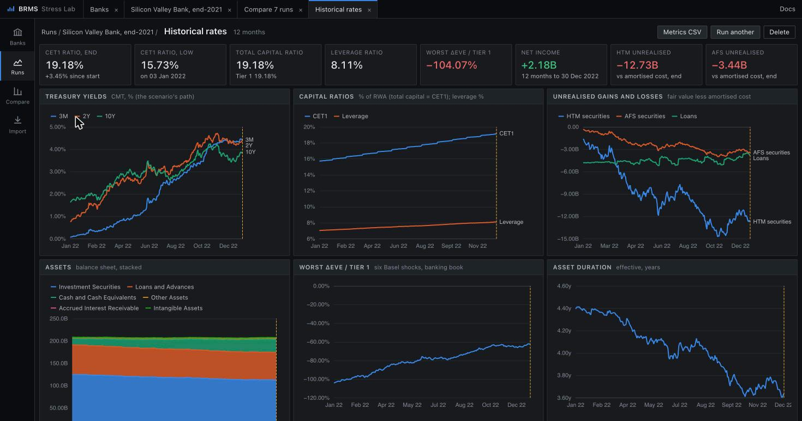

# Stress Lab

The Stress Lab runs a bank's balance sheet through interest-rate scenarios, one day at a time, with
full double-entry accounting. For every day it reports:

- **the books**: balance sheet, income statement and every journal entry;
- **regulatory capital**: CET1, Tier 1 and total capital ratios, risk-weighted assets, the leverage ratio;
- **unrealised gains and losses**: on held-to-maturity (HTM) and available-for-sale (AFS) securities and on loans;
- **interest-rate risk in the banking book**: economic value of equity (EVE) under the six Basel
  shocks, duration and net interest income (NII) sensitivity.



## Who it is for

- **Supervisors and central bankers.** Take any US bank's Call Report and see how its capital and
  unrealised losses respond to the Basel shocks, or to the rate path you are worried about.
- **Researchers.** Script thousands of runs from Python and get tidy pandas data back.
- **Students and teachers.** Watch the accounting of a bank day by day, and see why SVB failed
  while its regulatory capital looked fine.

## What it answers

- *How much of a bank's equity would unrealised losses wipe out if rates rose by 200bp?*
- *What would its CET1 ratio be if unrealised losses on AFS securities counted, as they do under
  Basel III?*
- *Which of these banks is most exposed to a steepening of the yield curve?*
- *If the bank sold its AFS book to meet a deposit run, what would it realise, and would the cash
  be enough?*

## Where to start

| If you want to… | Read |
|---|---|
| Try it in five minutes, in your browser | [Quick start](quickstart.md) |
| Understand why SVB failed, step by step | [Tutorial: SVB through 2022](tutorials/svb-2022.md) |
| Stress-test several banks with the Basel shocks | [Tutorial: the Basel shocks](tutorials/basel-shocks.md) |
| Load any US bank | [Tutorial: a bank from its Call Report](tutorials/call-report.md) |
| Describe your own bank | [Tutorial: build a bank from scratch](tutorials/bank-file.md) |
| Add a deposit run and a fire sale | [Tutorial: SVB's last week](tutorials/svb-last-week.md) |
| Script it | [Python and the command line](tutorials/python.md) |
| Know exactly what the engine assumes | [How the engine works](reference/engine.md) |

## Install

```bash
pip install "brms[web]"   # the lab, its browser app and the command line
```

`pip install brms` alone installs the library and the command line without the browser app.
Python 3.11 or later is needed.

## The banks it ships with

| Bank | As of | Why it is interesting |
|---|---|---|
| Silicon Valley Bank | end-2021 | $125bn of long, fixed-rate securities funded by deposits that left; failed March 2023 |
| Silicon Valley Bank | end-2022 | Ten weeks before it failed, with $15bn of unrealised losses on HTM securities |
| Signature Bank | end-2021 | Failed two days after SVB |
| First Republic Bank | end-2021 | Long fixed-rate mortgages; failed May 2023 |
| JPMorgan Chase Bank | end-2021 | The largest US bank, for comparison |
| Five teaching examples | Jan 2022 | One instrument each (a Treasury, a mortgage, a floating loan…) and a small diversified bank |

The real banks are built from their public Call Reports (FDIC BankFind) and saved with the
package, so they work offline. See [how a Call Report becomes a bank](reference/call-report.md).

## How good is it?

On Silicon Valley Bank, the engine reproduces the unrealised losses SVB reported for 2022 to within
a few percentage points of amortised cost. [Validation](validation.md) has the details and the
gaps.
