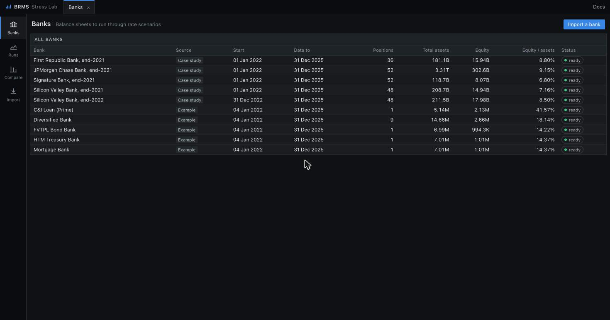
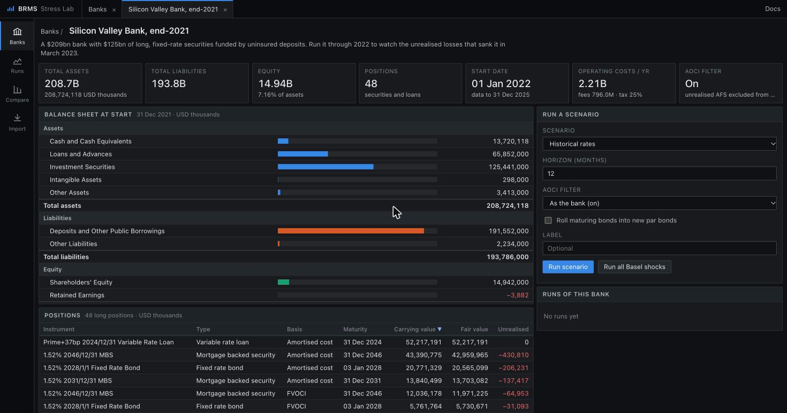
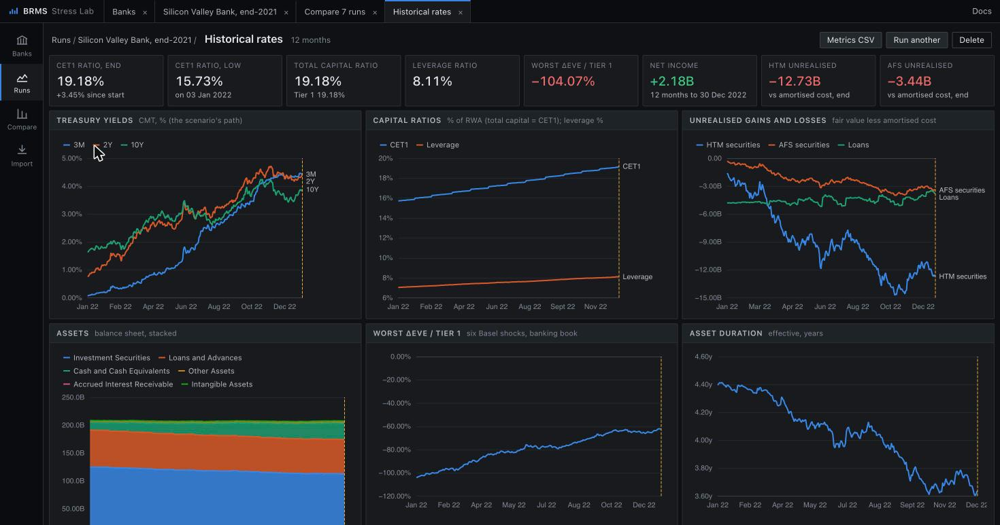
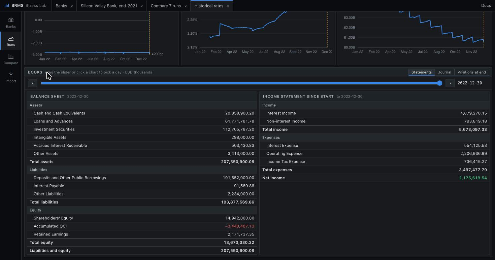
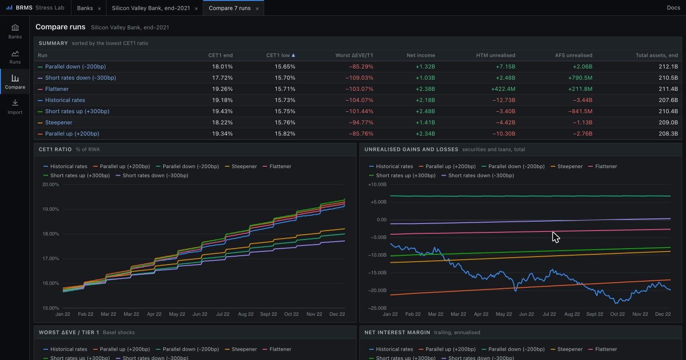

# Quick start

Five minutes, no code. You will run Silicon Valley Bank through the actual interest rates of 2022
and see what happened to its securities and its capital.

## 1. Install and start

```bash
pip install "brms[web]"
brms-web
```

Your browser opens at <http://127.0.0.1:8765>. If it does not, open that address yourself.
Keep the terminal open: it is the server. Press ++ctrl+c++ there to stop it.

!!! tip "Port already in use?"
    Start it on another port: `brms-web --port 8800`.

## 2. Pick a bank

The **Banks** page lists the banks that ship with the lab: five real banks (case studies) and five
small teaching examples.



Click **Silicon Valley Bank, end-2021**.

## 3. Look at the balance sheet



- The tiles at the top give the size of the bank, its equity, its annual operating costs and
  whether the **AOCI filter** is on (see below).
- **Balance sheet at start** is the bank on 31 December 2021, built from its Call Report. Figures
  in tables are in **USD thousands**, as filed: 208,724,118 is $208.7bn.
- **Positions** lists every security and loan with its carrying value, fair value and unrealised
  gain or loss. Click a column heading to sort.

## 4. Run a scenario

In **Run a scenario** on the right:

1. Leave **Scenario** on **Historical rates** (the US Treasury yields that actually happened).
2. Leave **Horizon** at **12** months.
3. Click **Run scenario**.

The run takes about fifteen seconds; the page shows its progress and then the results.

## 5. Read the results



The tiles summarise the year:

| Tile | What it says for SVB in 2022 |
|---|---|
| CET1 ratio, end | 19.2%: regulatory capital looked strong… |
| HTM unrealised | −$12.7bn: …but its held-to-maturity securities had lost $12.7bn of value |
| AFS unrealised | −$3.4bn more on available-for-sale securities |
| Net income | +$2.2bn of profit after costs and tax |

Against equity of $14.9bn, the unrealised losses were larger than all of the bank's capital,
yet the CET1 ratio rose. Why? HTM securities are held at amortised cost, so their losses never
reach the books, and SVB used the **AOCI filter**, which keeps AFS losses out of CET1 too.

The charts below the tiles show each measure day by day: the rate path, capital ratios,
unrealised gains and losses by book, the balance sheet, economic value, duration, NII sensitivity
and more. Hover over a chart to read values.

## 6. Look inside the books

Scroll down to **Books**. Drag the slider, or click on any chart, to pick a day:

- **Statements** shows the balance sheet that day and the income statement since the start.
- **Journal** shows every journal entry posted that day, with the instrument it belongs to.
- **Positions at end** lists each position's carrying value, amortised cost and fair value.



## 7. Stress it

Go back to the bank (click its name at the top) and click **Run all Basel shocks**. The lab
starts seven runs (historical rates plus the six standardised interest-rate shocks of the Basel
framework) and opens a comparison when they finish:



The summary table is sorted by the lowest CET1 ratio each scenario reached.

## Next

- [Tutorial: SVB through 2022](tutorials/svb-2022.md) explains these numbers and shows what
  happens when unrealised losses count in capital.
- [Tutorial: the Basel shocks](tutorials/basel-shocks.md) compares four banks under the same shock.
- [Tutorial: a bank from its Call Report](tutorials/call-report.md) loads any US bank.
