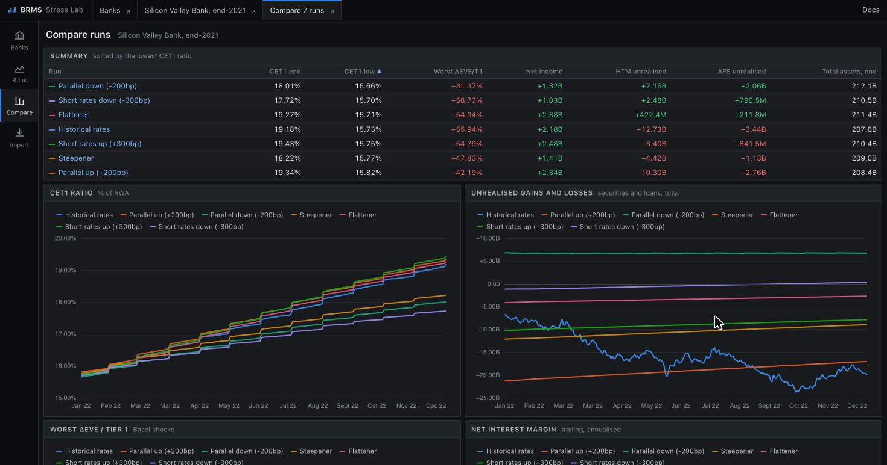
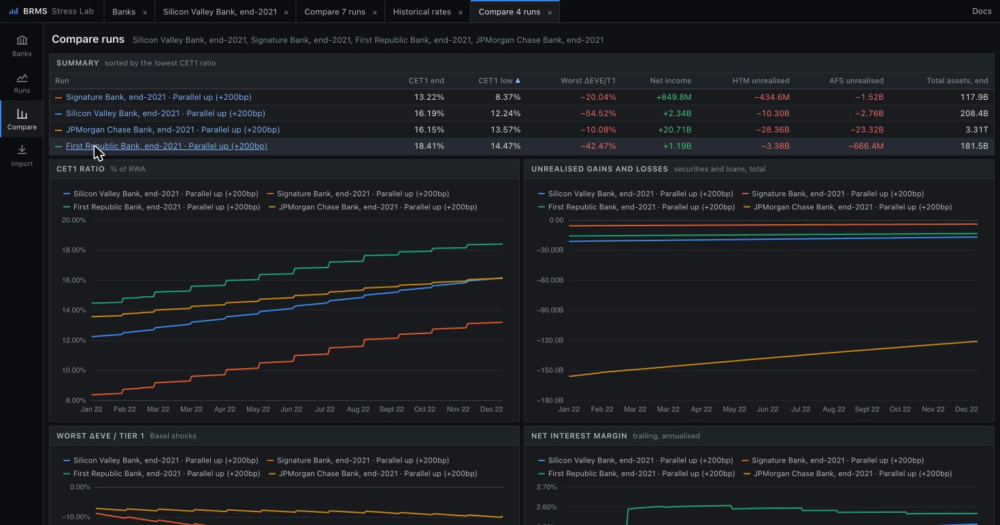

# Tutorial: the Basel shocks

**Time:** 20 minutes · **You need:** the browser app · **You will learn:** what the six Basel
interest-rate shocks are, how to run them, and how to compare banks under the same shock.

## The six shocks

The Basel Committee's standard for interest-rate risk in the banking book (IRRBB, SRP31) defines
six shocks to the yield curve. For US dollars:

| Shock | What moves | Size |
|---|---|---|
| Parallel up | every maturity | +200bp |
| Parallel down | every maturity | −200bp |
| Short rates up | short maturities, fading with maturity | +300bp at the short end |
| Short rates down | the same, downwards | −300bp at the short end |
| Steepener | short rates down, long rates up | −195bp short, +135bp long |
| Flattener | short rates up, long rates down | +240bp short, −90bp long |

The short-rate shocks decay with maturity *t* in years as e−t/4. The steepener and
flattener combine the short and long shapes. Supervisors use these shocks to compare banks: a bank
whose economic value falls by more than 15% of Tier 1 capital in the worst of the six is an
*outlier* that draws attention.

In the lab a shock is applied on the start date to the Treasury curve, and the curve then stays
at that shocked level for the whole horizon. You can also phase a shock in over a number of days.

## Part 1: all six shocks on one bank

1. Open **Banks → Silicon Valley Bank, end-2021**.
2. Leave the horizon at 12 months and click **Run all Basel shocks**.

The lab starts seven runs (historical rates plus the six shocks) and opens **Compare** when they
finish. The summary table is sorted by each run's lowest CET1 ratio. Look at:

- **HTM unrealised**: the parallel-up shock costs SVB −$10.3bn on HTM securities, and the
  actual path of 2022 cost −$12.7bn. The real 2022 was worse than the regulatory +200bp shock,
  because the 10-year yield rose about 240bp.
- **Worst ΔEVE/T1**: SVB's economic value falls by more than half of its Tier 1 capital in the
  worst shock. That makes it a clear outlier against the 15% threshold.

## Part 2: four banks under the same shock

Now compare four banks under **Parallel up (+200bp)**, with unrealised AFS losses counted in
capital, as Basel III requires.

For each of **Silicon Valley Bank, end-2021**, **Signature Bank, end-2021**, **First Republic
Bank, end-2021** and **JPMorgan Chase Bank, end-2021**:

1. Open the bank.
2. In **Run a scenario**, choose **Basel IRRBB shocks → Parallel up (+200bp)**, horizon **12**,
   **AOCI filter: Off**.
3. Click **Run scenario**.

Then open **Runs**, tick the four runs and click **Compare 4 selected**. Each run is labelled with
its bank:

| Bank | Lowest CET1 ratio | Worst ΔEVE / Tier 1 | HTM unrealised | AFS unrealised |
|---|---:|---:|---:|---:|
| Signature Bank | **8.4%** | −20% | −$0.4bn | −$1.5bn |
| Silicon Valley Bank | 12.2% | **−55%** | −$10.3bn | −$2.8bn |
| JPMorgan Chase Bank | 13.6% | −10% | −$28.4bn | −$23.3bn |
| First Republic Bank | 14.5% | −42% | −$3.4bn | −$0.7bn |

How to read it:

- **Capital.** With AOCI counted, the shock hits CET1 on day one through AFS losses. Signature
  starts with the thinnest capital and drops to 8.4%. All four then recover as profits accumulate.
- **Economic value.** ΔEVE revalues every asset and liability at the shocked rates, including the
  stable (core) part of deposits. Three of the four banks are outliers against the 15% threshold;
  JPMorgan is not. SVB is the most exposed: long securities, funded by deposits that were 95%
  uninsured and so count as less stable. First Republic's exposure is in long fixed-rate mortgages,
  which are loans rather than securities: they show up in EVE and in loan unrealised losses, not in
  HTM or AFS.
- **Size.** JPMorgan's dollar losses are the largest, but against its capital its economic-value
  loss is the smallest, and its larger share of insured retail deposits offsets more of it. Its
  CET1 ratio is lower than First Republic's because $46bn of goodwill and other intangibles is
  deducted from its capital.

!!! info "Deposits in ΔEVE"
    Core deposits follow the Basel caps, weighted by each bank's insured share
    ([assumptions](../guides/assumptions.md#deposits)). Untick **Core deposits** when importing a
    bank to see the exposure of the assets alone.

## Part 3: phase a shock in

A shock that arrives over a year is gentler than one that arrives overnight, because the bank
keeps earning while it builds. On SVB, run **Parallel up (+200bp)** with **Phase in over (days)**
set to **365**, and compare it with the instant shock. The unrealised losses end in the same
place; the CET1 path is smoother.

## Part 4: your own curve shift

Choose **Key-rate shift…** and enter a shift in basis points at 3M, 1Y, 2Y, 5Y, 10Y and 30Y.
Between those maturities the shift is interpolated linearly; beyond them it is flat. For example,
a bear flattener: 3M **+300**, 1Y **+250**, 2Y **+200**, 5Y **+100**, 10Y **+50**, 30Y **+25**.

## What you have learned

- The six Basel shocks give a common yardstick across banks.
- Capital measures (with or without AOCI) and economic value tell different stories: one is the
  accounting view, the other the market view of the whole balance sheet.
- A shock's speed matters for capital, not for the final unrealised loss.
