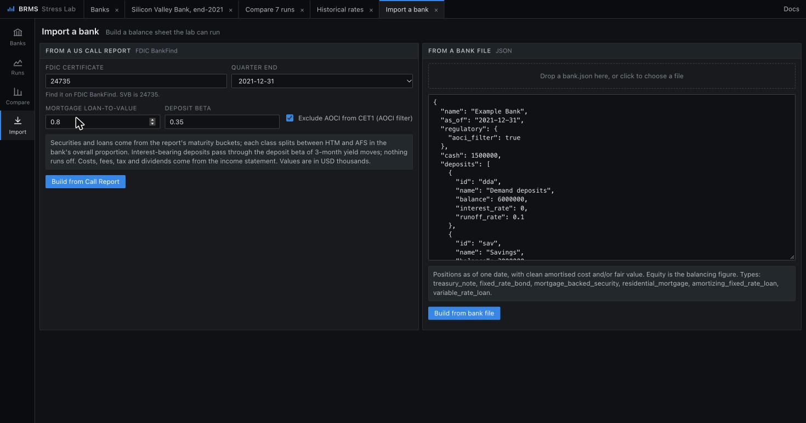

# Tutorial: a bank from its Call Report

**Time:** 15 minutes · **You need:** the browser app and an internet connection · **You will learn:**
how to load any US insured bank, what the lab builds from its filing, and which assumptions to
check.

Every FDIC-insured bank in the United States files a *Call Report* each quarter: its balance
sheet, income statement and capital, with securities and loans broken down by how soon they mature
or reprice. The FDIC publishes these filings through its free BankFind API, and the lab reads them.

## Step 1: find the bank's certificate number

Each bank has an FDIC certificate number.

1. Go to [FDIC BankFind](https://banks.data.fdic.gov/bankfind-suite/bankfind).
2. Search for the bank by name.
3. The certificate number (**FDIC Cert #**) is on the bank's page.

Some examples: Silicon Valley Bank **24735**, Signature Bank **57053**, First Republic Bank
**59017**, JPMorgan Chase Bank **628**, Bank of America **3510**, Wells Fargo Bank **3511**.

!!! note "Banks, not holding companies"
    Call Reports cover the insured bank, not its parent holding company (for example *Silicon
    Valley Bank*, not *SVB Financial Group*). Figures differ somewhat from the group's 10-K.

## Step 2: import it

In the browser app, open **Import**. Under **From a US Call Report**:



1. **FDIC certificate:** the number from Step 1.
2. **Quarter end:** the filing to use. The filing for a quarter appears about 30 days after
   quarter end.
3. **Mortgage loan-to-value:** the lab needs a loan-to-value ratio to risk-weight 1–4 family
   mortgages; Call Reports do not give one. 0.8 is a reasonable average.
4. **Deposit beta:** the share of each move in the 3-month Treasury yield passed on to
   interest-bearing deposits. 0.35 is roughly the US average through 2022–23; banks with
   rate-sensitive depositors are higher.
5. **AOCI filter:** tick it for banks that exclude AOCI from capital (most US banks below the
   largest size); untick it for the largest banks, or to apply Basel III.
6. **Core deposits in EVE:** keep it ticked to treat the stable part of deposits as long-lived in
   the economic-value measure, following the Basel caps weighted by the bank's insured share.
7. Click **Build from Call Report**.

The lab fetches the filing, builds the bank (a few seconds) and opens its page.

## Step 3: check what was built

The lab turns the filing into about 50 positions. Check the bank page against the filing:

- **Total assets and equity** should be close to the reported figures. Equity is the balancing
  figure of what the lab models, plus other assets and liabilities carried as they are.
- **Operating costs / yr** shows the annualised non-interest expense, fee income and effective tax
  rate taken from the income statement.
- **Positions** shows the securities and loans. Names tell you what each one is: for example
  `1.52% 2046/12/31 MBS` is the mortgage pass-throughs with more than 15 years to maturity, at the
  bank's average securities yield.

How each line of the Call Report becomes a position is set out in the
[Call Report mapping](../reference/call-report.md). The points that matter most:

| Assumption | Why it matters | What to do |
|---|---|---|
| HTM and AFS split in the bank's overall proportion within each security class | The filing does not say which securities sit in which book | If you know the AFS mix (10-K, FR Y-9C), use the Python `afs=` option (below) |
| Each maturity bucket becomes one instrument at the bucket midpoint | Drives duration and therefore unrealised losses | Accept it for comparisons across banks |
| Deposits do not run off | A deposit run is the key liquidity risk | Add a **Liquidity stress** to the run, or `runoff_rate` and `withdrawals` to the bank file ([example](svb-last-week.md)) |
| Operational-risk RWA is estimated | Affects the capital ratios' level | Compare with the reported RWA in the bank file's `reported` block |

## Step 4: run it

Run historical rates or the Basel shocks as in the [Quick start](../quickstart.md). Remember
that the bank is frozen at the filing date: the lab does not add new loans, new deposits or
securities purchases.

## From Python or the command line

The same import, without the browser:

=== "Command line"

    ```bash
    python -m brms.lab call-report --cert 24735 --date 2021-12-31 --out svb.json
    python -m brms.lab build-bank svb.json --out svb.zip
    python -m brms.lab run svb.zip --scenario historical --scenario parallel+200 --months 12 --out results
    ```

=== "Python"

    ```python
    import datetime
    from pathlib import Path
    import json

    from brms.lab import Historical, run
    from brms.lab.bank_file import build_bank, default_market_frames, prime_on
    from brms.lab.call_report import bank_file_from_call_report, fetch_call_report

    items = fetch_call_report(24735, "2021-12-31")
    frames = default_market_frames()
    bank = bank_file_from_call_report(
        items,
        prime=prime_on(frames, datetime.date(2021, 12, 31)),
        deposit_beta=0.35,
        # SVB's AFS book by class, from its 10-K (USD thousands): mostly Treasuries.
        afs={"treasury": 15_850_000, "other_debt": 257_000, "pass_through": 8_589_000, "other_mbs": 2_525_000},
    )
    Path("svb.json").write_text(json.dumps(bank, indent=1))
    result = run(build_bank(Path("svb.json"), frames, Path("svb.zip")), Historical(), months=12)
    print(result.summary)
    ```

The bank file is plain JSON: open `svb.json`, edit any assumption (a deposit's `beta`, a
`runoff_rate`, the `operating` block), and build again.

## Troubleshooting

| Message | Meaning |
|---|---|
| *The report date must be a quarter end* | Use 31 March, 30 June, 30 September or 31 December. |
| *No Call Report for FDIC certificate … on …* | The bank did not file for that quarter (not yet published, merged or closed), or the number is wrong. |
| *The FDIC API answered 429* | The API is busy; the lab retries three times. Wait a minute and try again. |
| *Cannot compute … the denominator is 0* | The filing lacks an item the mapping needs (a bank with no securities, for example). Build the bank from a [bank file](bank-file.md) instead. |
