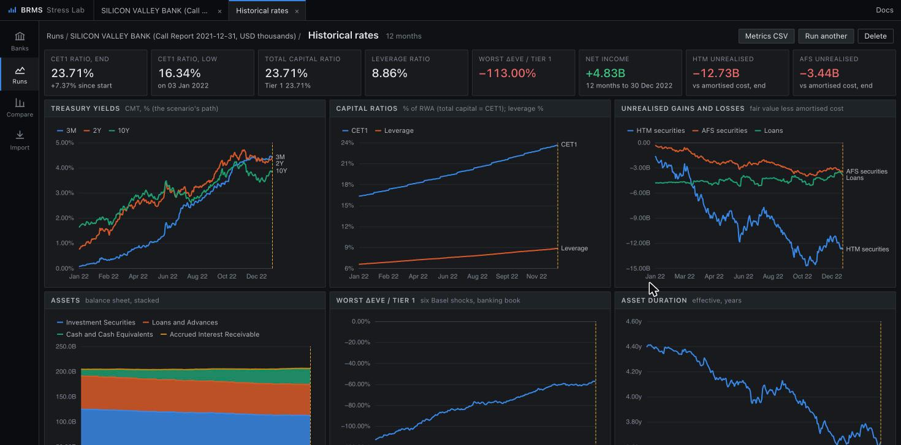

# The lab in a browser

```bash
pip install "brms[web]"
brms-web
```



`brms-web` starts a local server at <http://127.0.0.1:8765> and opens it in your browser. Banks and
runs are saved in `~/.brms-web` (or `--data-dir`, or `$BRMS_WEB_HOME`), so they survive a restart.

## What you can do

- **Banks.** Five demo banks ship with the package. Import more from a US bank's
  [Call Report](call_report.md) (FDIC certificate number and quarter end) or from a
  [bank file](index.md#describe-a-bank) (upload or paste JSON).
- **Run a scenario.** On a bank's page, pick:
  - **Scenario:** historical rates, one of the six Basel shocks, a parallel shift, or a
    key-rate shift (basis points at 3M, 1Y, 2Y, 5Y, 10Y and 30Y);
  - **Horizon** and **phase-in:** how many months to run, and over how many days a shock
    builds up;
  - **Options:** the AOCI filter, and rolling maturing bonds into new ones.

  **Run all Basel shocks** starts the six shocks and historical rates together and opens the
  comparison.
- **Read a run.**
  - **Headline figures:** CET1 ratio at the end and its low point, total capital, leverage,
    the worst change in economic value against Tier 1, net income, and unrealised gains and
    losses on held-to-maturity and AFS securities.
  - **Charts over the horizon:** the rate path, capital ratios, unrealised gains and losses by
    book, assets, economic value, duration, NII sensitivity, net interest margin and credit RWA.
  - **Any day's books:** click a chart or drag the slider to see that day's balance sheet,
    income statement since the start and journal entries. Positions at the end are listed too,
    and **Metrics CSV** downloads every daily metric.
- **Compare runs** of a bank: the same measures overlaid, one line per run, with a summary table
  sorted by the lowest CET1 ratio.

Each run happens in its own worker process (`--workers`, default 2, run at once). A 12-month run
of a bank with about 50 positions takes 10–20 seconds.

## Figures and units

Call Report banks are in USD thousands, as filed. Headline figures and charts are scaled to dollars
(`$12.7B`); full-precision tables keep the filed units and say so ("USD thousands").

Net income has no operating expenses: the engine models interest, marks and sales, not costs. Read
it as pre-expense earnings. Economic value treats deposits as repricing overnight, which makes rising
rates look worse than a behavioural deposit model would (see [what the engine assumes](index.md#what-the-engine-assumes)).

## On a server

```bash
brms-web --host 0.0.0.0 --port 8765 --data-dir /srv/brms --workers 4 --no-browser
```

The server has no user accounts or rate limits yet. Anyone who can reach it can build banks and
start runs, so keep it behind your own authentication (a reverse proxy with login) when it is
reachable from outside.
